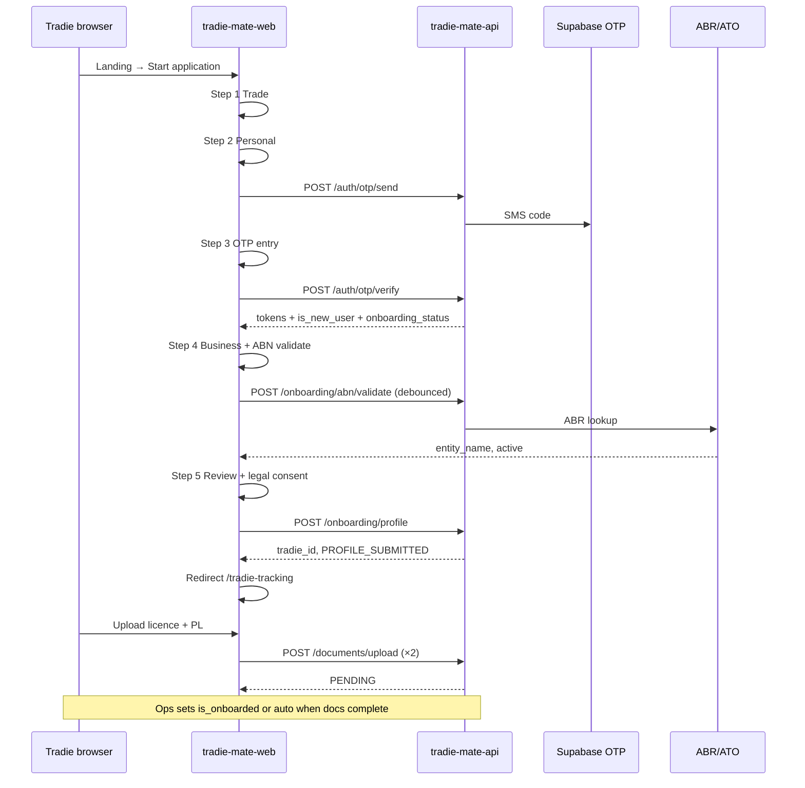

# P0 — Tradie Registration: Flow, Validation & UX (Detailed Spec)

**Parent:** [P0 Tradie Registration Implementation Plan](./P0_tradie_registration_implementation_plan.md)  
**Audience:** Frontend, backend, QA, design  
**Scope:** Web onboarding (`/tradie-onboarding`) + document portal (`/tradie-tracking`) + supporting API

---

## 1. Design principles (UX)

| Principle | Implementation |
| --- | --- |
| **Progressive disclosure** | Collect phone early for OTP, but do not ask for documents until profile exists. |
| **Fail fast, recover easy** | Inline validation on blur/submit; preserve form state on API errors; no wipe on 400. |
| **Field-first language** | Errors name the field and the fix (*"Enter an 11-digit ABN"*, not *"Validation failed"*). |
| **One primary action per screen** | Single CTA (`Continue` / `Verify` / `Submit`); secondary = Back only. |
| **Trust without overclaiming** | Use *"Checked"* / *"Uploaded"* — avoid *"Government approved"* until registry integration (Phase 4). |
| **Gloved-hand / outdoor** | Min `44px` touch targets, high contrast, no shadow-only affordances ([Design System](./README.md#required-tokens)). |
| **Resume later** | JWT + `onboarding_status` from API; return user to correct step on reload. |

---

## 2. End-to-end flow (canonical)

### 2.1 Happy path



### 2.2 Entry points & guards

| Entry | Guard | Redirect if |
| --- | --- | --- |
| `/tradie-onboarding` | None (public) | Already `APPROVED_FOR_BETA` → app download CTA or dashboard deep link |
| `/tradie-onboarding` | Valid session, `PROFILE_SUBMITTED+` | `/tradie-tracking` |
| `/tradie-tracking` | Bearer token | `/tradie-onboarding?step=verify` if no token |
| `/tradie-tracking` | `onboarding_status` &lt; `PROFILE_SUBMITTED` | `/tradie-onboarding` (resume step from API) |

### 2.3 Resume / return visit

On mount of `/tradie-onboarding`:

1. If no token → start Step 1.
2. If token → `GET /onboarding/status`:
   - `PHONE_VERIFIED` → Step 4 (business) — Steps 1–2 data from draft in `sessionStorage` or re-prompt if missing.
   - `PROFILE_SUBMITTED` | `DOCS_*` → redirect `/tradie-tracking`.
   - `APPROVED_FOR_BETA` → success / download app screen.

**Draft storage key:** `tradiemate_onboarding_draft` (JSON, no secrets). Clear on successful profile submit.

### 2.4 Error & branch flows

| Event | UX | API code |
| --- | --- | --- |
| OTP rate limited | Banner: wait 10 min; disable Resend | `429` `OTP_RATE_LIMIT` |
| Wrong OTP | Shake inputs; inline *"Code incorrect — try again"* | `401` |
| ABN invalid Luhn | Inline red; block Continue on step 4 | `400` `ABN_INVALID` |
| ABN inactive at ATO | Inline + link to fix ABN; offer *"Request manual review"* (beta) | `400` `ABN_INACTIVE` |
| ABR down | Amber banner; allow submit with `PENDING_MANUAL_REVIEW` | `503` `ABR_UNAVAILABLE` |
| Profile already exists | Redirect tracking; toast *"Welcome back"* | `409` `PROFILE_EXISTS` |
| Token expired mid-flow | Modal → re-verify phone (OTP step) | `401` `TOKEN_EXPIRED` |
| Network offline | Sticky banner; queue draft locally | — |
| Legal version mismatch | Force reload app / show update legal message | `400` `TERMS_VERSION_MISMATCH` |
| Upload too large | *"Max 10 MB — try a photo or compressed PDF"* | `413` |
| Wrong file type | *"Use PDF, JPG, or PNG"* | `400` `INVALID_FILE_TYPE` |

---

## 3. Step model (6 UI steps → 5 form + 1 portal)

Refactor current 4-step UI to match this order:

| UI step | Route query | `onboarding_events.step` | Can go back? |
| --- | --- | --- | --- |
| 1. Trade | `?step=trade` | — | Exit to `/` |
| 2. Personal | `?step=personal` | — | Yes |
| 3. Verify phone | `?step=verify` | `OTP_SENT`, `OTP_VERIFIED` | Yes (re-send OTP) |
| 4. Business | `?step=business` | — | Yes (not after profile submitted) |
| 5. Review & submit | `?step=review` | `PROFILE_SUBMITTED` | Yes |
| 6. Documents (portal) | `/tradie-tracking` | `DOC_UPLOADED` | N/A |

**Progress indicator:** 5 segments (exclude portal); fill through current step; completed steps show check icon.

---

## 4. Per-step UX specification

### Step 1 — Trade (`step=trade`)

**Goal:** One tap to declare primary trade; optional experience for analytics only.

| Element | Spec |
| --- | --- |
| **Headline** | *"What's your primary trade?"* |
| **Subcopy** | *"You can add more services later in the app."* |
| **Control** | Grid of trade chips (2 cols mobile, 3 desktop). Single select. |
| **Optional** | Experience band: `&lt;1 year` \| `1–3` \| `3–5` \| `5+` (segmented control) |
| **Primary CTA** | `Continue` — disabled until trade selected |
| **Validation** | `tradeType` required (maps to API enum — see parent plan §9.5) |

**Empty/error:** N/A (selection UI).

**Analytics:** `onboarding_trade_selected`, `onboarding_step_completed` `{ step: 'trade' }`.

---

### Step 2 — Personal (`step=personal`)

**Goal:** Collect contact details; normalize AU phone before OTP.

| Field | Control | Placeholder |
| --- | --- | --- |
| `firstName` | Text | *"First name"* |
| `lastName` | Text | *"Last name"* |
| `email` | `type=email` | *"you@business.com.au"* |
| `phone` | `type=tel` + mask | *"04XX XXX XXX"* |

**UX details:**

- Auto-focus `firstName` on enter.
- Phone: on blur, normalize to E.164 `+614XXXXXXXX` (strip spaces; `04` → `+614`).
- Show helper under phone: *"We'll text you a verification code. Standard SMS rates may apply."*
- Email helper: *"Used for receipts and account recovery."*

**Continue behaviour:** Validate client-side → call `POST /auth/otp/send` → on success navigate `?step=verify` (do not advance until SMS sent).

**Loading:** CTA shows spinner *"Sending code…"*; disable Back.

---

### Step 3 — Verify phone (`step=verify`)

**Goal:** Prove phone ownership; establish session.

| Element | Spec |
| --- | --- |
| **Headline** | *"Enter the 6-digit code"* |
| **Subcopy** | *"Sent to +61 4XX XXX XXX"* (masked) + `Change number` link → back to personal |
| **OTP input** | 6 boxes `56×56px`, auto-advance, backspace moves back, paste full code supported |
| **Resend** | Disabled 60s countdown: *"Resend code in 0:59"* → then link *"Resend code"* |
| **Primary CTA** | `Verify` — auto-submit when 6 digits entered (optional) or manual tap |
| **Dev bypass** | `+61412345678` + `123456` when `NODE_ENV=development` (API mock) |

**States:**

| State | UI |
| --- | --- |
| Verifying | CTA spinner; inputs disabled |
| Success | Brief success check → auto-advance `?step=business` |
| Invalid | Red border on boxes; message below |
| Rate limited | Amber banner top |

**Session:** Store `access_token`, `refresh_token`, `expires_at`, `tradie_id` (nullable) in `sessionStorage` via `useOnboardingSession`.

**Analytics:** `otp_sent`, `otp_verified`, `otp_failed` `{ reason }`.

---

### Step 4 — Business (`step=business`)

**Goal:** Business identity + ABN; declare PL intent (real doc on portal).

| Field | Control | Notes |
| --- | --- | --- |
| `businessName` | Text | Legal or trading name |
| `abn` | Text, formatted `XX XXX XXX XXX` | 11 digits |
| `hasPublicLiability` | Toggle/card | *"I hold public liability insurance"* — required `true` to continue (intent only) |

**ABN inline validation (client):**

1. On input: format groups; neutral if length &lt; 11.
2. On blur / 11 digits: Luhn check → red *"Invalid ABN"* or green *"Format OK — checking…"*.
3. Debounce 500ms → `POST /onboarding/abn/validate`:
   - Success + active: show `abnEntityName` from ATO: *"Registered as: DAVE PLUMBING PTY LTD"*.
   - Inactive: red + explain.
   - Network error: amber *"Can't reach ATO — you can still apply; we'll review manually."*

**Continue:** Enabled when `businessName` non-empty, Luhn pass, `hasPublicLiability === true`, and (ABN active OR manual-review path acknowledged).

**Analytics:** `abn_validate_success`, `abn_validate_fail`.

---

### Step 5 — Review & submit (`step=review`)

**Goal:** Confirm summary; capture legal consent; create profile.

**Summary card (read-only):**

- Trade, name, email, phone (masked), business name, ABN (formatted), PL declared ✓

**Legal:** [LegalConsentFields](../../tradie-mate-web/src/components/legal/LegalConsentFields.tsx) — all three required.

**Primary CTA:** `Submit application` — **not** *"Platinum partner"* (overclaim).  
**Loading:** *"Creating your profile…"* — disable navigation.

**API:** `POST /onboarding/profile` with body + `legal_consent` from `buildLegalConsentPayload()`.

**Success:**

- Clear draft storage.
- Toast: *"Application received — upload your documents next."*
- `navigate('/tradie-tracking')`.

**Failure:** Inline alert with `error.code`; preserve form; scroll to error.

---

### Step 6 — Document portal (`/tradie-tracking`)

**Goal:** Upload minimum docs for beta; set expectations on review time.

**Layout:**

1. `VerificationDisclaimerBanner` (top).
2. Header: *"Complete your verification"* + tradie name.
3. Progress ring: `2 required` — count uploaded / verified.
4. Checklist cards (see §6).

**Per document card:**

| State | Badge | Actions |
| --- | --- | --- |
| `MISSING` | Stone/muted | `Upload` |
| `PENDING` | Warning amber | filename, *"Under review — usually within 1 business day"`* |
| `UNDER_REVIEW` | Warning | same |
| `VERIFIED` | Success green | View, Replace |
| `REJECTED` | Danger | reason text + `Upload again` |
| `EXPIRED` | Danger | `Upload new`* |

**Upload modal / dropzone:**

- Accept: `.pdf`, `.jpg`, `.jpeg`, `.png`
- Max: 10 MB
- Camera capture on mobile (`capture="environment"`)
- Progress bar during upload
- On success: card → `PENDING`

**Required P0 types (align DB enum):**

| UI label | API `doc_type` |
| --- | --- |
| Trade licence | `TRADE_LICENCE` |
| Public liability insurance | `PUBLIC_LIABILITY_INSURANCE` |

**Footer CTA:** When both uploaded (any status except MISSING): *"Download TradieMate app"* + SMS reminder copy.

**Auth guard:** No token → redirect onboarding with message *"Verify your phone to continue"*.

---

## 5. Validation matrix (authoritative)

### 5.1 Client-side (Zod or equivalent in `packages/domain` / web)

```typescript
// Reference schema — implement once, share web + API
const phoneAU = z.string().transform(normalizeAuPhone).refine(isE164AuMobile)
const abn = z.string().transform(stripAbn).refine(len11).refine(luhnAbn)
const email = z.string().email().max(255)
const name = z.string().trim().min(1).max(50)
```

| Field | Client rules | Error copy (EN) |
| --- | --- | --- |
| `tradeType` | Required enum | *"Select your trade"* |
| `firstName` | 1–50 chars, letters/spaces/hyphen | *"Enter your first name"* |
| `lastName` | 1–50 chars | *"Enter your last name"* |
| `email` | Valid email, max 255 | *"Enter a valid email"* |
| `phone` | AU mobile E.164 `+614XXXXXXXX` | *"Enter a valid Australian mobile"* |
| `otp` | Exactly 6 digits | *"Enter the 6-digit code"* |
| `businessName` | 2–200 chars trim | *"Enter your business name"* |
| `abn` | 11 digits + Luhn | *"Enter a valid 11-digit ABN"* |
| `hasPublicLiability` | Must be `true` | *"Public liability is required to join"* |
| `legalConsent` | All three booleans true | *"Accept all agreements to continue"* |
| Upload file | MIME allow-list, ≤10MB | See §4 step 6 |

### 5.2 Server-side (API — always re-validate)

| Field | Server rules | HTTP | `error.code` |
| --- | --- | --- | --- |
| `phone` | E.164; matches OTP session | 400 | `PHONE_MISMATCH` |
| `email` | Format; optional uniqueness warn | 400 | `INVALID_EMAIL` |
| `trade_type` | DB enum | 400 | `INVALID_TRADE_TYPE` |
| `abn` | Luhn + ABR lookup; cache 24h | 400/503 | `ABN_*` |
| `legal_consent` | Versions match `CURRENT_LEGAL_VERSIONS` | 400 | `*_VERSION_MISMATCH` |
| `authUserId` | No duplicate tradie | 409 | `PROFILE_EXISTS` |
| JWT | Valid, not expired | 401 | `TOKEN_EXPIRED` |
| `doc_type` | Enum; tradie exists | 403 | `TRADIE_NOT_FOUND` |
| File | Size, MIME, virus scan (P1) | 413/400 | `FILE_*` |

### 5.3 ABN verification states (shared UI + API)

| `abn_verification_status` | Meaning | User-visible label |
| --- | --- | --- |
| `UNVERIFIED` | Not yet checked | — |
| `VERIFIED` | ABR active + Luhn OK | *"ABN verified"* |
| `PENDING_MANUAL_REVIEW` | ABR down or mismatch | *"Pending review"* |
| `REJECTED` | Inactive/cancelled | *"ABN not active"* |

---

## 6. Onboarding status state machine (detailed)

### 6.1 States

```
PHONE_PENDING → PHONE_VERIFIED → PROFILE_SUBMITTED → DOCS_IN_PROGRESS → DOCS_SUBMITTED → APPROVED_FOR_BETA
                                      ↘ MANUAL_REVIEW (ABN)
DOCS_SUBMITTED → REJECTED (ops; rare P0)
```

### 6.2 Transition table

| From | Event | To | Side effects |
| --- | --- | --- | --- |
| — | `otp/send` | `PHONE_PENDING` | Redis rate limit |
| `PHONE_PENDING` | `otp/verify` OK, no tradie | `PHONE_VERIFIED` | JWT issued |
| `PHONE_VERIFIED` | `onboarding/profile` 201 | `PROFILE_SUBMITTED` | tradie row, ABN fields |
| `PROFILE_SUBMITTED` | First doc upload | `DOCS_IN_PROGRESS` | `trade_documents` row |
| `DOCS_IN_PROGRESS` | All required docs have row | `DOCS_SUBMITTED` | Notify ops (email/Slack P1) |
| `DOCS_SUBMITTED` | Ops `is_onboarded=true` | `APPROVED_FOR_BETA` | Push + email welcome |
| `PHONE_VERIFIED` | `onboarding/profile` + ABR fail override | `PROFILE_SUBMITTED` + `abn_verification_status=PENDING_MANUAL_REVIEW` | Flag for ops |

### 6.3 `GET /onboarding/status` drives UI

Response must include:

- `onboarding_status`
- `resume_step`: `trade` \| `personal` \| `verify` \| `business` \| `review` \| `tracking` \| `complete`
- `documents[]` with `MISSING` synthesized
- `blockers[]`: e.g. `["ABN_MANUAL_REVIEW", "DOC_TRADE_LICENCE_MISSING"]`

---

## 7. API request/response contracts (validation-focused)

### `POST /auth/otp/send`

```json
{ "phone": "+61412345678" }
```

| Check | Error |
| --- | --- |
| Required, E.164 AU | `400 INVALID_PHONE` |
| Rate limit 3/10min | `429 OTP_RATE_LIMIT` |

### `POST /auth/otp/verify`

```json
{ "phone": "+61412345678", "otp": "123456" }
```

| Check | Error |
| --- | --- |
| 6 digits | `400 INVALID_OTP_FORMAT` |
| Twilio verify fail | `401 OTP_INVALID` |

### `POST /onboarding/abn/validate`

```json
{ "abn": "12345678901" }
```

```json
{
  "success": true,
  "data": {
    "valid": true,
    "active": true,
    "entity_name": "DAVE PLUMBING PTY LTD",
    "gst_registered": true,
    "cached": false
  }
}
```

### `POST /onboarding/profile`

Full body in parent plan §6.3 plus:

```json
"legal_consent": {
  "terms_version": "2026-06-02",
  "privacy_version": "2026-06-02",
  "disclaimer_version": "2026-06-02",
  "accepted_at": "2026-06-02T10:00:00.000Z"
}
```

**Idempotency:** Same `authUserId` + identical payload → `200` with same `tradie_id` (no duplicate rows).

### `POST /documents/upload`

`multipart`: `file`, `doc_type` (`TRADE_LICENCE` \| `PUBLIC_LIABILITY_INSURANCE`)

| Check | Error |
| --- | --- |
| Auth + tradie | `401` / `403` |
| MIME in allow-list | `400 INVALID_FILE_TYPE` |
| ≤10MB | `413 FILE_TOO_LARGE` |

---

## 8. Component inventory (web)

| Component | Responsibility |
| --- | --- |
| `OnboardingLayout` | Split hero (desktop) + form column; progress stepper |
| `OnboardingStepper` | 5-step progress; accessible `aria-current` |
| `TradeCategoryGrid` | Step 1 selection |
| `PhoneInputAU` | Mask + normalize `+614` |
| `OtpInput` | 6-digit UX |
| `AbnInput` | Format + Luhn + API debounce hook |
| `LegalConsentFields` | Step 5 (exists) |
| `OnboardingSummaryCard` | Step 5 read-only |
| `DocumentChecklist` | Portal list |
| `UploadDropzone` | Drag/drop + camera |
| `ApiErrorAlert` | Maps `error.code` → copy |
| `useOnboardingSession` | Token read/write/refresh |
| `useOnboardingDraft` | sessionStorage draft |
| `useAbnValidation` | Debounced API |

---

## 9. Copy deck (customer-facing EN)

| Key | Copy |
| --- | --- |
| `onboarding.title` | *"Apply to TradieMate"* |
| `onboarding.subtitle` | *"Join Brisbane beta tradies — get paid faster, with less admin."* |
| `otp.sent` | *"Code sent. Check your messages."* |
| `abn.verified` | *"ABN verified with the Australian Business Register."* |
| `abn.manual` | *"We'll verify your ABN manually within 1 business day."* |
| `submit.success` | *"Application received. Upload your licence and insurance next."* |
| `tracking.title` | *"Upload your documents"* |
| `tracking.subtitle` | *"Required for beta access. Review usually within 1 business day."* |
| `tracking.complete_cta` | *"Download the app"* |

---

## 10. Accessibility & responsive

| Requirement | Spec |
| --- | --- |
| Focus order | Logical top → bottom; OTP boxes one tab-stop group with arrow keys |
| Labels | Every input has visible `<label>` or `aria-label` |
| Errors | `aria-invalid` + `aria-describedby` linking to error text |
| Progress | `aria-valuenow` on stepper |
| Contrast | Design system tokens only; no opacity-only state |
| Mobile | Single column; sticky footer CTA `52px` height |
| Desktop | Optional left brand panel; max form width `32rem` |

---

## 11. Analytics (minimum P0)

| Event | Properties |
| --- | --- |
| `onboarding_started` | `source` (landing, direct) |
| `onboarding_step_viewed` | `step` |
| `onboarding_step_completed` | `step`, `duration_ms` |
| `otp_sent` | `phone_country` |
| `otp_verified` | `is_new_user` |
| `abn_validation` | `result`: valid \| invalid \| inactive \| api_error |
| `onboarding_profile_submitted` | `trade_type`, `abn_status` |
| `document_uploaded` | `doc_type`, `file_size_kb` |
| `onboarding_abandoned` | `last_step` |

---

## 12. QA scenarios (UX + validation)

| # | Scenario | Expected |
| --- | --- | --- |
| 1 | Skip trade, tap Continue | Disabled CTA |
| 2 | Invalid phone `041` | Inline error, no OTP sent |
| 3 | Valid phone, wrong OTP ×3 | Error message; no lockout beyond Twilio |
| 4 | OTP rate limit 4th send | 429 banner |
| 5 | Valid OTP, back, change phone | Must re-verify |
| 6 | ABN fails Luhn | Cannot continue step 4 |
| 7 | ABR returns inactive | Error + manual path if enabled |
| 8 | Submit without legal checkboxes | Blocked step 5 |
| 9 | Reload mid-flow with token | Resume correct step via status API |
| 10 | Upload 12MB PDF | Client reject before API |
| 11 | Upload `.exe` | Rejected |
| 12 | Token expired on tracking | Redirect to verify with message |

---

## 13. Implementation checklist (add to sprint)

| Task | Owner | Depends on |
| --- | --- | --- |
| Shared Zod schemas `onboarding.schema.ts` in API + copy to web | BE | — |
| `requireAuthUser` + status endpoint with `resume_step` | BE | migration |
| Refactor `TradieRegistration` to 5 steps + OTP | FE | API otp |
| `PhoneInputAU`, `OtpInput`, `AbnInput` components | FE | — |
| Wire `useOnboardingDraft` + resume | FE | status API |
| `DocumentChecklist` + upload | FE | documents API |
| Design system pass (remove font-black 700, shadows) | FE/Design | — |
| Playwright tests §12 | QA | FE |

---

## 14. Document links

- [P0 Implementation Plan](./P0_tradie_registration_implementation_plan.md) — API, DB, sprint
- [Module 1.3 OTP & ABN](./phase_1_build_seed/03_module_1_3_phone_otp_auth_abn_validation.md)
- [Module 2.2 Documents](./phase_2_transition_grow/02_module_2_2_tradie_onboarding_document_verification.md)
- [Design System README](./README.md#required-tokens)
