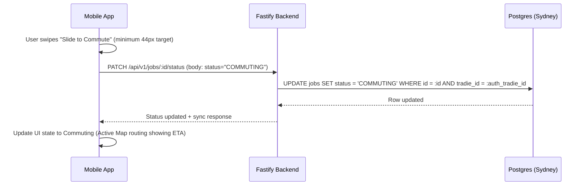

> Execution order: `01`  
> Parent phase: [Phase 1 — Build & Seed (M1–M8)](../phase_1_build_seed.md)  
> Previous: [Phase Overview](./00_phase_overview.md)

## 📌 Module 1.1: Dashboard & Job Detail (Core Navigation)
**Timeline**: Weeks 1–2
**Focus**: Daily driver screens for tradies. Designed for maximum readability under direct Australian sunlight and tactile usability with dirty or gloved hands.

### Business Value & Adoption Evaluation

**User intention**: "What jobs am I doing today, where am I going next, and what state is each job in?"

**Why users will use it**:
*   This is the daily entry point. If it is faster than checking a diary/SMS thread, it can become a morning habit.
*   Status changes create useful downstream automation: customer tracking, reminders, invoicing, and payment prompts.

**Adoption risk**:
*   If creating jobs is slower than writing a note or SMS, tradies will abandon the workflow before seeing invoice/payment value.
*   If the app requires too much clean data upfront, beta users will perceive it as admin software rather than field support.

**Retention mechanism**:
*   Every job added increases history value: customer name, address, notes, status, and future invoice link.
*   Recurring customer jobs should be clonable in a later iteration to turn history into time savings.

**Migration support**:
*   Add a fast "Quick Job" path with only customer name, phone, address, and rough time required.
*   Allow creating a job from phone contacts or pasted SMS text in a follow-up iteration.

**Success metrics**:
*   Job creation completion rate.
*   Median time to create a job.
*   Percentage of jobs with status updated at least once.
*   Day-7 return rate for users who created 3+ jobs.

**Build detail additions**:
*   Track analytics events: `job_created`, `job_detail_opened`, `job_status_changed`, `quick_job_started`, `quick_job_completed`.
*   Store `source` on jobs: `MANUAL`, `CONTACT_IMPORT`, `CALL_TO_JOB`, `ENTERPRISE`, `MARKETPLACE`.
*   Add empty states that prompt the next action: "Add today's first job" rather than generic blank lists.

### 📱 Mobile UX & UI Specifications (React Native)

> **Design System Instruction**: Implement this UI using `TradieMate_Design_System.html` v1.0 tokens: light mode only, base `#FAFAF8`, elevated cards `#FFFFFF`, CTA `#2E6B45`, semantic success/warning/danger/info colors, Inter typography, 4px spacing scale, `8px` element radius, `12px` card radius, minimum `44px` touch targets, `0.5px` borders, no shadows, no gradients, and MaterialCommunityIcons with explicit size/color, preferring library icons over typed text symbols for actions and statuses. This supersedes any older orange CTA, thick-border, or hard-shadow wording in the detailed bullets below. Build this UI from shared primitives in `packages/ui` (`AppButton`, `IconButton`, `AppCard`, `StatusBadge`, `EmptyState`, `FormField`, `Stepper`, `SwipeConfirm`, `ModalShell`, `MapPanel`) before creating module-local components.

#### 🎨 Visual Design Tokens & styling
*   **Colors**: 
    *   Main Canvas Background: `#FAFAF8` (`--bg-base`).
    *   Secondary Surface: `#EDECEA` (`--bg-surface`).
    *   Card Container: `#FFFFFF` (`--bg-elevated`), bound by a `0.5px` solid line of `#E8E6E0` (`--border`).
    *   Interactive State / Primary Nav: `#2E6B45` (`--cta` Forest Green).
    *   Urgent Accents: `#E24B4A` (`--danger`) for priority indicators.
*   **Typography (Inter Font)**:
    *   Greeting: Display or section title scale (`28px/500` or `22px/500`) to stand out immediately without using bold `700`.
    *   Metadata / Labels: section label scale (`10px`, weight `500`, uppercase, letter spacing `0.06em`) in `#888888`.
*   **Card Surface (No Shadow)**:
    *   Cards must not use drop shadows or hard offset shadows. Use flat elevation through surface, border, and spacing:
        ```javascript
        cardSurface: {
          backgroundColor: '#FFFFFF',
          borderWidth: 0.5,
          borderColor: '#E8E6E0',
          borderRadius: 12,
          padding: 20,
        }
        ```

#### 👆 Usability & Gloved-Hand Tactility
*   **Touch Targets**: Every actionable element must occupy a minimum bounding box of `44px x 44px`. Use `52px` or `56px` height for critical primary actions. Ensure at least `12px` of breathing room between clickable elements to avoid false taps.
*   **Haptic Feedback Loop**:
    *   Trigger `impactLight` on standard item taps.
    *   Trigger `impactMedium` on button confirmation.

#### 🔄 Micro-interactions & Transitions
*   **Tactile Commute Slider**:
    *   Uses a swipe-activated track. As the user drags the slider handle, execute a continuous haptic "tick" (`selection` feedback).
    *   If the user drops the handle before it reaches `80%` of the track width, run a smooth spring animation snapping the handle back to `0%` with a subtle elastic bounce.
    *   Upon crossing the `80%` threshold, trigger `notificationSuccess` haptics, lock the handle at `100%`, and slide the entire action block out vertically to reveal the active routing panel.
*   **Pressed State**:
    *   Buttons should feel responsive without shadows. Use a subtle opacity and scale change:
        ```javascript
        transform: [{ scale: 0.98 }],
        opacity: 0.92
        ```
*   **Floating Action Button (FAB) Stack**:
    *   Primary FAB (`+ New Job`, `#2E6B45`) has a `56px` diameter and uses the MCI `plus` icon. The secondary buttons slide out vertically from behind the primary button on tap, using a staggered spring animation (`damping: 15`).

---

### 🔌 API & Database Specification

#### 🗄️ Drizzle Database Schema (`src/db/schema.ts`)
```typescript
import { pgTable, uuid, varchar, text, doublePrecision, timestamp, pgEnum } from 'drizzle-orm/pg-core';

export const jobStatusEnum = pgEnum('job_status', ['PENDING', 'COMMUTING', 'IN_PROGRESS', 'COMPLETED', 'CANCELLED']);

export const jobs = pgTable('jobs', {
  id: uuid('id').defaultRandom().primaryKey(),
  tradieId: uuid('tradie_id').notNull(), // Linked to Auth user metadata
  customerName: varchar('customer_name', { length: 255 }).notNull(),
  customerPhone: varchar('customer_phone', { length: 20 }).notNull(),
  address: text('address').notNull(),
  latitude: doublePrecision('latitude').notNull(),
  longitude: doublePrecision('longitude').notNull(),
  status: jobStatusEnum('status').default('PENDING').notNull(),
  notes: text('notes'),
  scheduledStart: timestamp('scheduled_start', { withTimezone: true }).notNull(),
  scheduledEnd: timestamp('scheduled_end', { withTimezone: true }).notNull(),
  createdAt: timestamp('created_at', { withTimezone: true }).defaultNow().notNull(),
  updatedAt: timestamp('updated_at', { withTimezone: true }).defaultNow().notNull(),
});
```

#### 🛣️ Endpoints Details

##### 1. `GET /api/v1/jobs`
*   **Auth**: Bearer JWT (Fastify Middleware validates `request.user.id`).
*   **Query Parameters**:
    ```json
    {
      "status": "string (optional: PENDING | COMMUTING | IN_PROGRESS | COMPLETED | CANCELLED)",
      "limit": "integer (optional, default: 20)",
      "offset": "integer (optional, default: 0)"
    }
    ```
*   **Response (`200 OK`)**:
    ```json
    {
      "success": true,
      "data": {
        "jobs": [
          {
            "id": "7fa85c8e-5b12-42da-912f-92762a4d3345",
            "customerName": "John Smith",
            "customerPhone": "+61412345678",
            "address": "45 Bunnings Rd, Fortitude Valley QLD 4006",
            "latitude": -27.45678,
            "longitude": 153.03456,
            "status": "PENDING",
            "scheduledStart": "2026-05-26T08:00:00+10:00",
            "scheduledEnd": "2026-05-26T10:00:00+10:00",
            "notes": "Bring spare copper pipe valves."
          }
        ],
        "meta": {
          "total": 1,
          "limit": 20,
          "offset": 0
        }
      }
    }
    ```
*   **Response (`401 Unauthorized`)**:
    ```json
    {
      "success": false,
      "error": {
        "statusCode": 401,
        "code": "AUTH_INVALID_TOKEN",
        "message": "The access token provided is expired or invalid."
      }
    }
    ```
*   **Workflow Evaluation**:
    *   **Pre-conditions**: Tradie has active jobs registered in Brisbane. JWT stored in `$TOKEN`.
    *   **Test Request**:
        ```bash
        curl -H "Authorization: Bearer $TOKEN" "http://localhost:3000/api/v1/jobs?status=PENDING"
        ```
    *   **Expected Assertions**:
        *   **HTTP Status**: `200 OK`
        *   **Response**: Standardized envelope with `success: true` and `data` wrapping `jobs` and `meta`.
        *   **Database Validation**: Confirms a read query to `jobs` table filtered by `tradie_id` and `status`.

##### 2. `GET /api/v1/jobs/:id`
*   **Auth**: Bearer JWT.
*   **Response (`200 OK`)**:
    ```json
    {
      "success": true,
      "data": {
        "id": "7fa85c8e-5b12-42da-912f-92762a4d3345",
        "customerName": "John Smith",
        "customerPhone": "+61412345678",
        "address": "45 Bunnings Rd, Fortitude Valley QLD 4006",
        "latitude": -27.45678,
        "longitude": 153.03456,
        "status": "PENDING",
        "notes": "Bring spare copper pipe valves.",
        "scheduledStart": "2026-05-26T08:00:00+10:00",
        "scheduledEnd": "2026-05-26T10:00:00+10:00"
      }
    }
    ```
*   **Response (`404 Not Found`)**:
    ```json
    {
      "success": false,
      "error": {
        "statusCode": 404,
        "code": "JOB_NOT_FOUND",
        "message": "Job not found or you do not have permission to view it."
      }
    }
    ```
*   **Workflow Evaluation**:
    *   **Pre-conditions**: Job with ID `$JOB_ID` belongs to the authenticated tradie. JWT stored in `$TOKEN`.
    *   **Test Request**:
        ```bash
        curl -H "Authorization: Bearer $TOKEN" "http://localhost:3000/api/v1/jobs/$JOB_ID"
        ```
    *   **Expected Assertions**:
        *   **HTTP Status**: `200 OK`
        *   **Response**: Standardized envelope with `success: true` and matching job details inside `data`.
        *   **Database Validation**: Single row read from `jobs` matching the job UUID.
        *   **Failure Check**: Requesting a non-existent or other user's job UUID returns `404 Not Found` with `success: false` and `JOB_NOT_FOUND` nested in `error`.

##### 3. `PATCH /api/v1/jobs/:id/status`
*   **Auth**: Bearer JWT.
*   **Request Body**:
    ```json
    {
      "status": "COMMUTING"
    }
    ```
*   **Business Logic Validation (State Transition Checks)**:
    *   Verify that the job belongs to the authenticated tradie. If not, return `404 Not Found`.
    *   Enforce standard state transitions. Allowed steps:
        *   `PENDING` -> `COMMUTING`
        *   `COMMUTING` -> `IN_PROGRESS`
        *   `IN_PROGRESS` -> `COMPLETED`
        *   Any active state -> `CANCELLED`
    *   If the requested transition violates this flow (e.g., direct `PENDING` -> `COMPLETED`), block the update and return `400 Bad Request`.
*   **Response (`200 OK`)**:
    ```json
    {
      "success": true,
      "data": {
        "id": "7fa85c8e-5b12-42da-912f-92762a4d3345",
        "status": "COMMUTING",
        "updatedAt": "2026-05-25T22:15:30Z"
      }
    }
    ```
*   **Response (`400 Bad Request`)**:
    ```json
    {
      "success": false,
      "error": {
        "statusCode": 400,
        "code": "INVALID_JOB_TRANSITION",
        "message": "Cannot transition status directly from PENDING to COMPLETED."
      }
    }
    ```
*   **Workflow Evaluation**:
    *   **Pre-conditions**: Job `$JOB_ID` is in state `PENDING` and assigned to auth tradie. JWT stored in `$TOKEN`.
    *   **Test Request (Transition Success)**:
        ```bash
        curl -X PATCH -H "Authorization: Bearer $TOKEN" \
          -H "Content-Type: application/json" \
          -d '{"status": "COMMUTING"}' \
          "http://localhost:3000/api/v1/jobs/$JOB_ID/status"
        ```
    *   **Expected Assertions (Success)**:
        *   **HTTP Status**: `200 OK`
        *   **Response**: Standardized envelope with `success: true` and status updated inside `data`.
        *   **Database Validation**: Column `status` in table `jobs` is successfully updated to `COMMUTING`, and `updatedAt` matches execution timestamp.
    *   **Test Request (Invalid Transition)**: Try transitioning from `PENDING` directly to `COMPLETED`.
        ```bash
        curl -X PATCH -H "Authorization: Bearer $TOKEN" \
          -H "Content-Type: application/json" \
          -d '{"status": "COMPLETED"}' \
          "http://localhost:3000/api/v1/jobs/$JOB_ID/status"
        ```
    *   **Expected Assertions (Failure)**:
        *   **HTTP Status**: `400 Bad Request`
        *   **Response**: Standardized error envelope with `success: false` and `INVALID_JOB_TRANSITION` code nested in `error`.
        *   **Database Validation**: Column `status` remains unchanged.

### 🔄 Action Workflow: Commute Lifecycle


---
