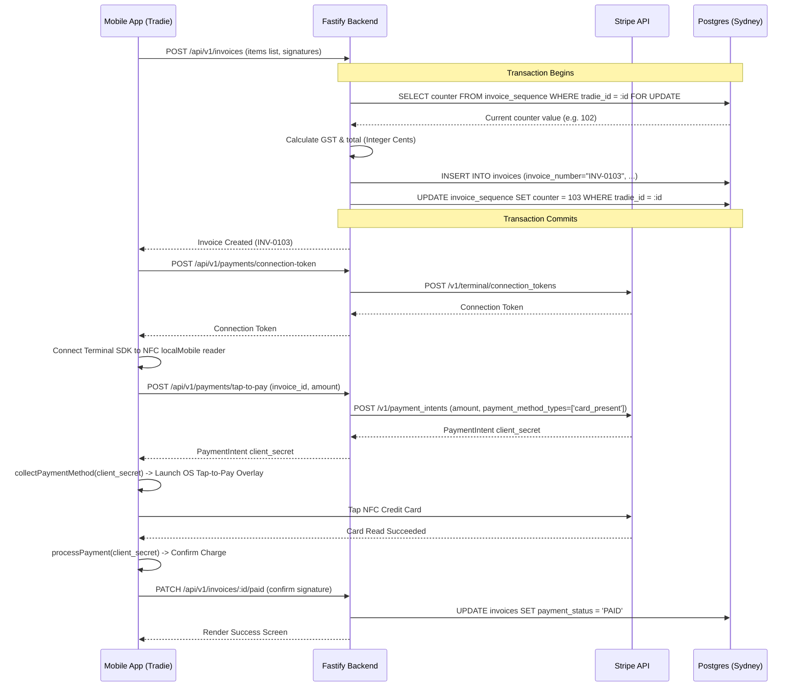

> Execution order: `02`  
> Parent phase: [Phase 1 — Build & Seed (M1–M8)](../phase_1_build_seed.md)  
> Previous: [📌 Module 1.1: Dashboard & Job Detail (Core Navigation)](./01_module_1_1_dashboard_job_detail_core_navigation.md)

## 📌 Module 1.2: Invoice & Stripe Tap to Pay
**Timeline**: Week 3
**Focus**: Quick itemized invoice generator and contactless credit card processing on-site.

### Business Value & Adoption Evaluation

**User intention**: "I finished the job; help me charge the customer now before I leave."

**Why users will use it**:
*   Faster payment is one of the clearest willingness-to-pay drivers for solo tradies.
*   Tap to Pay removes dependency on a separate reader, which is a strong migration hook from Square/Stripe hardware.
*   Invoice history creates a financial source of truth that keeps users returning.

**Adoption risk**:
*   Tradies may distrust payment handling if payout timing, fees, and failure states are unclear.
*   Complex item entry can slow the onsite moment; default labour/parts templates will be needed quickly.

**Retention mechanism**:
*   Paid/unpaid status, receipt history, and invoice sequencing make leaving harder once real revenue flows through the app.
*   Later Xero sync turns this module into the bridge from field work to bookkeeping.

**Migration support**:
*   Position this as "same card habit, less hardware" for Square/Stripe users.
*   Add reusable line-item presets for common materials and call-out fees.
*   Export PDF/CSV for users who still need to send records to accountants manually before Xero integration.

**Success metrics**:
*   Invoice creation rate per active tradie.
*   Payment collection rate per invoice.
*   Average time from job completed to invoice created.
*   Failed payment recovery rate.
*   Percentage of invoices using item presets once presets exist.

**Build detail additions**:
*   Add `invoiceStatus`: `DRAFT`, `ISSUED`, `PAID`, `VOID`, `SYNC_PENDING`.
*   Add `paymentEvents` audit table for Stripe webhook, client confirmation, retry, and reconciliation events.
*   Generate PDF receipts asynchronously and send SMS/email receipt links.
*   Add fee disclosure copy before Tap to Pay confirmation.

### 📱 Mobile UX & UI Specifications (React Native)

> **Design System Instruction**: Implement this UI using `TradieMate_Design_System.html` v1.0 tokens: light mode only, base `#FAFAF8`, elevated cards `#FFFFFF`, CTA `#2E6B45`, semantic success/warning/danger/info colors, Inter typography, 4px spacing scale, `8px` element radius, `12px` card radius, minimum `44px` touch targets, `0.5px` borders, no shadows, no gradients, and MaterialCommunityIcons with explicit size/color, preferring library icons over typed text symbols for actions and statuses. This supersedes any older orange CTA, thick-border, or hard-shadow wording in the detailed bullets below. Build this UI from shared primitives in `packages/ui` (`AppButton`, `IconButton`, `AppCard`, `StatusBadge`, `EmptyState`, `FormField`, `Stepper`, `SwipeConfirm`, `ModalShell`, `MapPanel`) before creating module-local components.

#### 📝 Invoicing Builder UX
*   **Quantity Selector Controls**:
    *   Do not force tradies to type numbers on a small keyboard. Use big `+` and `-` buttons with a minimum size of `52px x 52px`.
    *   When adjusting quantities, display a brief scale animation (`scale: 1.1` dynamic bounce) on the value indicator.
    *   Trigger `impactLight` haptics on each value increment/decrement.
*   **GST Auto-Calculator Display**:
    *   Keep the Subtotal, GST (10%), and Total fields sticky at the bottom of the screen.
    *   Update values instantly. When values change, slide the numbers up/down dynamically (using layout transitions) to draw focus to the new totals.

#### ✍️ Digital Signature Capture
*   **Signature Area Canvas**:
    *   Minimum height `200px` with a defined dashed border outline (`#E8E6E0`).
    *   *Usability*: Enforce landscape-only canvas mode if the device rotates. Display helper text: *"Customer signs here"*.
    *   Provide clear, large `Clear` and `Undo` action buttons (`44px` minimum height) adjacent to the canvas.
    *   Validate that a signature has at least `10` distinct coordinate points before letting the user save (preventing accidental taps from being registered as signatures).

#### 💳 Stripe Tap to Pay Flow
*   **Stripe Terminal Integration**:
    *   To turn the tradie's phone into a contactless payment terminal, integrate `@stripe/stripe-terminal-react-native` (Stripe Terminal SDK).
    *   **Reader Connection Workflow**:
        *   The mobile app fetches a Terminal Connection Token from the backend API.
        *   The app triggers `discoverReaders` with discovery method `localMobile` to detect the phone's native NFC reader.
        *   The app connects to the reader. Once connected, it caches the connection state locally.
    *   **Tap-to-Pay Processing overlay**:
        *   On pressing the `Collect Payment` button, request the backend to generate a `card_present` PaymentIntent.
        *   Pass the PaymentIntent client secret to the SDK's `collectPaymentMethod` function.
        *   This launches the native OS payment sheet: Apple's native Tap to Pay card reading overlay on iOS, or Stripe's card reading screen on Android.
        *   Instruct the user: *"Hold card to the NFC reader on the back of the phone"*.
        *   Upon card read, trigger `processPayment` via the Terminal SDK to authorize the charge. If successful, play `notificationSuccess` haptic; if failed, display the error and retry.

---

### 🔌 API & Database Specification

#### 🗄️ Drizzle Database Schema (`src/db/schema.ts`)
```typescript
import { integer } from 'drizzle-orm/pg-core';

export const invoices = pgTable('invoices', {
  id: uuid('id').defaultRandom().primaryKey(),
  jobId: uuid('job_id').notNull(),
  tradieId: uuid('tradie_id').notNull(),
  invoiceNumber: varchar('invoice_number', { length: 50 }).notNull().unique(),
  amountSubtotal: integer('amount_subtotal').notNull(), // Stored in Cents
  amountGst: integer('amount_gst').notNull(), // Stored in Cents
  amountTotal: integer('amount_total').notNull(), // Stored in Cents
  paymentStatus: varchar('payment_status', { length: 20 }).default('UNPAID').notNull(), // 'UNPAID' | 'PAID'
  signatureUrl: text('signature_url'),
  createdAt: timestamp('created_at', { withTimezone: true }).defaultNow().notNull(),
});

export const invoiceItems = pgTable('invoice_items', {
  id: uuid('id').defaultRandom().primaryKey(),
  invoiceId: uuid('invoice_id').notNull(),
  description: varchar('description', { length: 255 }).notNull(),
  quantity: integer('quantity').notNull(),
  unitPrice: integer('unit_price').notNull(), // Stored in Cents
  totalPrice: integer('total_price').notNull(), // Stored in Cents
});

export const invoiceSequence = pgTable('invoice_sequence', {
  tradieId: uuid('tradie_id').primaryKey(),
  counter: integer('counter').default(0).notNull(),
});
```

#### 🛣️ Endpoints Details

##### 1. `POST /api/v1/invoices`
*   **Auth**: Bearer JWT.
*   **Request Body**:
    ```json
    {
      "jobId": "7fa85c8e-5b12-42da-912f-92762a4d3345",
      "items": [
        {
          "description": "Copper valve 15mm",
          "quantity": 2,
          "unitPrice": 1500
        },
        {
          "description": "Plumbing labour hour",
          "quantity": 1,
          "unitPrice": 8500
        }
      ]
    }
    ```
*   **Business Logic / Calculations**:
    *   `amountSubtotal` is calculated as `SUM(quantity * unitPrice)` -> `(2 * 1500) + (1 * 8500) = 11500` (cents).
    *   `amountGst` is calculated at exactly 10%: `Math.round(amountSubtotal * 0.1)` -> `1150`.
    *   `amountTotal` is `amountSubtotal + amountGst` -> `12650`.
    *   Use Postgres Transaction blocks wrapping the query:
        1. Fetch current sequence `counter` for the `tradieId` using `SELECT counter FROM invoice_sequence WHERE tradie_id = $1 FOR UPDATE`. If missing, insert record starting at `0`.
        2. Format new invoice number: `INV-` + left-padded counter (`counter + 1`).
        3. Insert new row into `invoices`.
        4. Insert list of items into `invoice_items`.
        5. Increment the sequence tracker in `invoice_sequence`.
*   **Response (`201 Created`)**:
    ```json
    {
      "success": true,
      "data": {
        "id": "e2a1b94d-e9c8-419b-a67b-1cb8b77a0641",
        "invoiceNumber": "INV-0001",
        "amountSubtotal": 11500,
        "amountGst": 1150,
        "amountTotal": 12650,
        "paymentStatus": "UNPAID"
      }
    }
    ```
*   **Workflow Evaluation**:
    *   **Pre-conditions**: Job `$JOB_ID` exists for auth tradie. JWT stored in `$TOKEN`.
    *   **Test Request**:
        ```bash
        curl -X POST -H "Authorization: Bearer $TOKEN" \
          -H "Content-Type: application/json" \
          -d '{"jobId": "'"$JOB_ID"'", "items": [{"description": "Copper valve 15mm", "quantity": 2, "unitPrice": 1500}, {"description": "Plumbing labour hour", "quantity": 1, "unitPrice": 8500}]}' \
          "http://localhost:3000/api/v1/invoices"
        ```
    *   **Expected Assertions**:
        *   **HTTP Status**: `201 Created`
        *   **Response**: Standardized envelope with `success: true` and invoice fields inside `data` (with correct currency calculations in cents).
        *   **Database Validation**:
            *   Table `invoices` has 1 new row.
            *   Table `invoice_items` has 2 new rows linked to this invoice.
            *   `invoice_sequence` has its `counter` incremented atomically using `SELECT FOR UPDATE`.

##### 2. `POST /api/v1/payments/connection-token`
*   **Auth**: Bearer JWT.
*   **Response (`200 OK`)**:
    ```json
    {
      "success": true,
      "data": {
        "secret": "pst_1234567890abcdefghijklmn_secret"
      }
    }
    ```
*   **Error (`502 Bad Gateway`)**:
    ```json
    {
      "success": false,
      "error": {
        "statusCode": 502,
        "code": "STRIPE_API_ERROR",
        "message": "Stripe returned an error when generating the terminal token."
      }
    }
    ```
*   **Workflow Evaluation**:
    *   **Pre-conditions**: Active Stripe Terminal configuration in platform. JWT stored in `$TOKEN`.
    *   **Test Request**:
        ```bash
        curl -X POST -H "Authorization: Bearer $TOKEN" "http://localhost:3000/api/v1/payments/connection-token"
        ```
    *   **Expected Assertions**:
        *   **HTTP Status**: `200 OK`
        *   **Response**: Standardized envelope with `success: true` and terminal `secret` inside `data`.
        *   **Side Effects**: Verifies Stripe SDK API connectivity. Returns `502 Bad Gateway` (with `success: false` and `STRIPE_API_ERROR` inside `error`) if connection fails.

##### 3. `POST /api/v1/payments/tap-to-pay`
*   **Auth**: Bearer JWT.
*   **Request Body**:
    ```json
    {
      "invoiceId": "e2a1b94d-e9c8-419b-a67b-1cb8b77a0641"
    }
    ```
*   **Business Logic**:
    *   Find the invoice details. Verify it belongs to the tradie.
    *   Call Stripe SDK to create a PaymentIntent:
        ```javascript
        const paymentIntent = await stripe.paymentIntents.create({
          amount: invoice.amountTotal,
          currency: 'aud',
          payment_method_types: ['card_present'],
          capture_method: 'automatic',
          metadata: { invoiceId: invoice.id }
        });
        ```
*   **Response (`200 OK`)**:
    ```json
    {
      "success": true,
      "data": {
        "clientSecret": "pi_1G123abc_secret_123",
        "paymentIntentId": "pi_1G123abc"
      }
    }
    ```
*   **Workflow Evaluation**:
    *   **Pre-conditions**: Invoice `$INVOICE_ID` exists in `UNPAID` state. JWT stored in `$TOKEN`.
    *   **Test Request**:
        ```bash
        curl -X POST -H "Authorization: Bearer $TOKEN" \
          -H "Content-Type: application/json" \
          -d '{"invoiceId": "'"$INVOICE_ID"'"}' \
          "http://localhost:3000/api/v1/payments/tap-to-pay"
        ```
    *   **Expected Assertions**:
        *   **HTTP Status**: `200 OK`
        *   **Response**: Standardized envelope with `success: true` and Stripe details inside `data`.
        *   **Side Effects**: A PaymentIntent is created on Stripe's side with metadata matching `invoiceId` and `payment_method_types: ['card_present']`.

##### 4. `PATCH /api/v1/invoices/:id/paid`
*   **Auth**: Bearer JWT.
*   **Request Body**:
    ```json
    {
      "signatureData": "data:image/png;base64,iVBORw0KGgoAAA..."
    }
    ```
*   **Business Logic**:
    *   Upload the base64 signature image to AWS S3 (`ap-southeast-2` bucket).
    *   Save the resulting URL in the `signatureUrl` column.
    *   Update `paymentStatus` to `'PAID'`.
*   **Response (`200 OK`)**:
    ```json
    {
      "success": true,
      "data": {
        "invoiceId": "e2a1b94d-e9c8-419b-a67b-1cb8b77a0641",
        "status": "PAID",
        "signatureUrl": "https://s3.ap-southeast-2.amazonaws.com/tradiemate-signatures/e2a1b94d.png"
      }
    }
    ```
*   **Workflow Evaluation**:
    *   **Pre-conditions**: Invoice `$INVOICE_ID` is unpaid. JWT stored in `$TOKEN`.
    *   **Test Request**:
        ```bash
        curl -X PATCH -H "Authorization: Bearer $TOKEN" \
          -H "Content-Type: application/json" \
          -d '{"signatureData": "data:image/png;base64,iVBORw0KGgoAAA..."}' \
          "http://localhost:3000/api/v1/invoices/$INVOICE_ID/paid"
        ```
    *   **Expected Assertions**:
        *   **HTTP Status**: `200 OK`
        *   **Response**: Standardized envelope with `success: true` and payment status inside `data`.
        *   **Database Validation**: Table `invoices` updated with `paymentStatus = 'PAID'` and `signatureUrl` populated with the S3 path.
        *   **Side Effects**: Verifies the signature Base64 string is correctly processed and uploaded to the AWS S3 Sydney bucket (`ap-southeast-2`).

### 🔄 Action Workflow: Invoice Sequence & Payment


---
