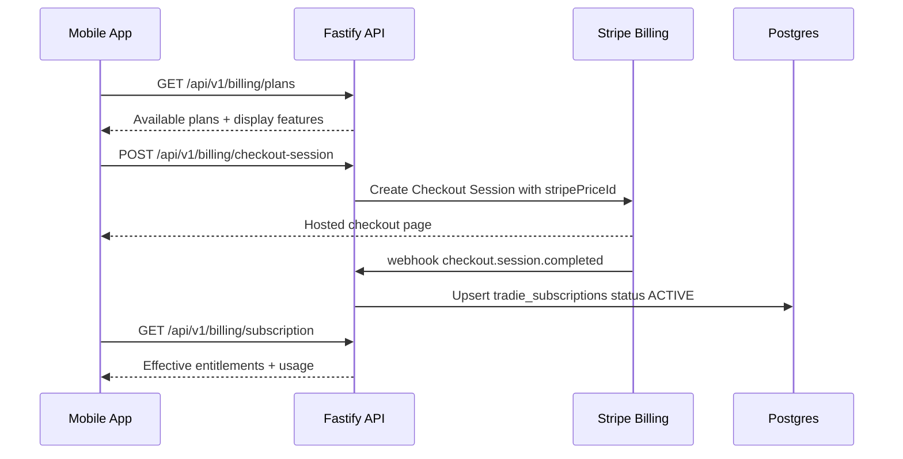

> Execution order: `05`  
> Parent phase: [Phase 1 — Build & Seed (M1–M8)](../phase_1_build_seed.md)  
> Previous: [📌 Module 1.4: Push Notifications & Offline Mode](./04_module_1_4_push_notifications_offline_mode.md)

## 📌 Module 1.5: Tradie Subscription, Plans & Entitlements
**Timeline**: Month 2
**Focus**: Flexible SaaS billing for tradies using Stripe Billing, with server-side entitlement checks that can evolve as pricing changes.

### Business Value & Adoption Evaluation

**User intention**: "Let me try TradieMate, understand what I am paying for, and upgrade only when the app is actually helping me run jobs."

**Why users will use it**:
*   A trial or founder plan reduces early friction while still creating a path to paid MRR.
*   Entitlement-based plans let the business test packaging without rebuilding API logic.
*   Team seats and add-ons create expansion revenue once solo value is proven.

**Adoption risk**:
*   Paywalling too early can stop users before they create their first job/invoice.
*   Confusing plan limits can feel punitive to tradies who are already busy.
*   Mobile-only gating is unsafe because users can bypass UI checks; all paid features need backend enforcement.

**Retention mechanism**:
*   Billing is tied to recurring operational value: invoices, payment collection, customer tracking, reviews, accounting sync, and team management.
*   Grace periods prevent accidental churn from expired cards while still protecting paid capabilities.

**Migration support**:
*   Support founder/beta overrides so early Brisbane tradies can be manually comped or discounted.
*   Allow "migration credit" for users moving from ServiceM8, Tradify, or other paid tools.

**Success metrics**:
*   Trial start-to-activation rate.
*   Trial-to-paid conversion.
*   Paywall view-to-upgrade conversion.
*   Failed payment recovery rate.
*   Plan downgrade/cancel reasons.
*   Average revenue per paying tradie and expansion revenue from seats/add-ons.

**Flexible pricing rule**:
*   Feature code must check entitlements, not plan names. For example, `requireEntitlement('xeroSyncEnabled')` is allowed; `if (plan === 'PRO')` is not allowed.
*   AUD prices, Stripe `priceId`s, trial length, limits, and add-on bundles must be data-driven through database rows or environment-backed seed config.

### 📱 Mobile UX & UI Specifications (React Native)

> **Design System Instruction**: Implement this UI using `TradieMate_Design_System.html` v1.0 tokens: light mode only, base `#FAFAF8`, elevated cards `#FFFFFF`, CTA `#2E6B45`, semantic success/warning/danger/info colors, Inter typography, 4px spacing scale, `8px` element radius, `12px` card radius, minimum `44px` touch targets, `0.5px` borders, no shadows, no gradients, and MaterialCommunityIcons with explicit size/color, preferring library icons over typed text symbols for actions and statuses. This supersedes any older orange CTA, thick-border, or hard-shadow wording in the detailed bullets below. Build this UI from shared primitives in `packages/ui` (`AppButton`, `IconButton`, `AppCard`, `StatusBadge`, `EmptyState`, `FormField`, `Stepper`, `SwipeConfirm`, `ModalShell`, `MapPanel`) before creating module-local components.

#### 💳 Subscription & Paywall UX
*   **Trial State**:
    *   Show a small status badge on the account screen: `TRIAL`, `ACTIVE`, `PAST DUE`, or `CANCELLED`.
    *   Display trial expiry copy in plain language: *"Your trial ends on 18 June 2026."*
*   **Plan Selection**:
    *   Render plan cards using `#FFFFFF`, `0.5px` border, `12px` radius, and no shadow.
    *   Each plan card shows included capabilities, usage limits, and whether Tap to Pay, Xero, customer tracking, team seats, or AI features are available.
    *   Primary action uses `Subscribe` or `Start Trial`; secondary action uses `Maybe Later` during pre-paywall onboarding only.
*   **Usage Limit Warning**:
    *   When the user is close to a plan limit, show a Warning badge and a clear upgrade CTA.
    *   Example: *"You have used 8 of 10 invoices this month."*
*   **Past Due State**:
    *   Do not lock the user out of viewing job/invoice history.
    *   Disable creation of new paid-feature records after the grace period, and show `Update Payment Method`.
*   **App Store Constraint**:
    *   If selling digital SaaS access inside iOS, use the approved billing model required by Apple policy. If using Stripe Billing for B2B/account management, purchase and payment-method update flows should happen in an external web billing portal where compliant.

---

### 🔌 API & Database Specification

#### 🗄️ Drizzle Database Schema (`src/db/schema.ts`)
```typescript
import { boolean, integer, jsonb, pgEnum, pgTable, text, timestamp, uuid, varchar } from 'drizzle-orm/pg-core';

export const subscriptionStatusEnum = pgEnum('subscription_status', [
  'TRIALING',
  'ACTIVE',
  'PAST_DUE',
  'CANCELED',
  'INCOMPLETE',
]);

export const billingIntervalEnum = pgEnum('billing_interval', ['MONTH', 'YEAR']);

export const subscriptionPlans = pgTable('subscription_plans', {
  id: uuid('id').defaultRandom().primaryKey(),
  code: varchar('code', { length: 80 }).notNull().unique(), // e.g. SOLO_STARTER, SOLO_PRO, TEAM
  displayName: varchar('display_name', { length: 120 }).notNull(),
  description: text('description'),
  priceCents: integer('price_cents').notNull(),
  currency: varchar('currency', { length: 3 }).default('AUD').notNull(),
  billingInterval: billingIntervalEnum('billing_interval').default('MONTH').notNull(),
  stripePriceId: varchar('stripe_price_id', { length: 255 }).notNull(),
  isPublic: boolean('is_public').default(true).notNull(),
  sortOrder: integer('sort_order').default(0).notNull(),
  createdAt: timestamp('created_at', { withTimezone: true }).defaultNow().notNull(),
});

export const planEntitlements = pgTable('plan_entitlements', {
  id: uuid('id').defaultRandom().primaryKey(),
  planCode: varchar('plan_code', { length: 80 }).notNull(),
  entitlements: jsonb('entitlements').notNull(), // feature flags + usage limits
  createdAt: timestamp('created_at', { withTimezone: true }).defaultNow().notNull(),
});

export const tradieSubscriptions = pgTable('tradie_subscriptions', {
  id: uuid('id').defaultRandom().primaryKey(),
  tradieId: uuid('tradie_id').notNull(),
  planCode: varchar('plan_code', { length: 80 }).notNull(),
  status: subscriptionStatusEnum('status').default('TRIALING').notNull(),
  stripeCustomerId: varchar('stripe_customer_id', { length: 255 }),
  stripeSubscriptionId: varchar('stripe_subscription_id', { length: 255 }),
  trialEndsAt: timestamp('trial_ends_at', { withTimezone: true }),
  currentPeriodStart: timestamp('current_period_start', { withTimezone: true }),
  currentPeriodEnd: timestamp('current_period_end', { withTimezone: true }),
  cancelAtPeriodEnd: boolean('cancel_at_period_end').default(false).notNull(),
  createdAt: timestamp('created_at', { withTimezone: true }).defaultNow().notNull(),
  updatedAt: timestamp('updated_at', { withTimezone: true }).defaultNow().notNull(),
});

export const entitlementOverrides = pgTable('entitlement_overrides', {
  id: uuid('id').defaultRandom().primaryKey(),
  tradieId: uuid('tradie_id').notNull(),
  entitlements: jsonb('entitlements').notNull(),
  reason: text('reason').notNull(), // founder, beta, migration credit, support comp
  expiresAt: timestamp('expires_at', { withTimezone: true }),
  createdAt: timestamp('created_at', { withTimezone: true }).defaultNow().notNull(),
});

export const usageCounters = pgTable('usage_counters', {
  id: uuid('id').defaultRandom().primaryKey(),
  tradieId: uuid('tradie_id').notNull(),
  key: varchar('key', { length: 120 }).notNull(), // invoices_created, tracking_sms_sent
  periodStart: timestamp('period_start', { withTimezone: true }).notNull(),
  periodEnd: timestamp('period_end', { withTimezone: true }).notNull(),
  count: integer('count').default(0).notNull(),
  updatedAt: timestamp('updated_at', { withTimezone: true }).defaultNow().notNull(),
});
```

#### Suggested Seed Plans (Configurable, Not Hard-Coded)

| Plan | Intent | Example entitlements |
| --- | --- | --- |
| `SOLO_STARTER` | First paid plan for solo tradies. | `maxJobsPerMonth`, `maxInvoicesPerMonth`, basic receipts, offline sync. |
| `SOLO_PRO` | Best default for serious solo operators. | Higher limits, Tap to Pay, customer tracking, review requests, Xero export/sync. |
| `TEAM` | Small trade businesses with staff. | Team seats, assignment, admin view, staff permissions, higher SMS/OCR limits. |

Example entitlement payload:
```json
{
  "maxJobsPerMonth": 50,
  "maxInvoicesPerMonth": 50,
  "tapToPayEnabled": true,
  "customerTrackingEnabled": true,
  "reviewRequestsEnabled": true,
  "xeroSyncEnabled": false,
  "teamMembersLimit": 1,
  "callToJobEnabled": false,
  "aiVoiceEnabled": false
}
```

#### 🛣️ Endpoints Details

##### 1. `GET /api/v1/billing/plans`
*   **Auth**: Optional Bearer JWT.
*   **Business Logic**:
    *   Return public plans from `subscription_plans`.
    *   Include display entitlements only; do not expose internal override logic.
*   **Response (`200 OK`)**:
    ```json
    {
      "success": true,
      "data": {
        "plans": [
          {
            "code": "SOLO_PRO",
            "displayName": "Solo Pro",
            "priceCents": 4900,
            "currency": "AUD",
            "billingInterval": "MONTH",
            "features": ["Tap to Pay", "Customer tracking", "Review requests"]
          }
        ]
      }
    }
    ```

##### 2. `GET /api/v1/billing/subscription`
*   **Auth**: Bearer JWT.
*   **Business Logic**:
    *   Return current subscription, merged effective entitlements, usage counters, and grace-period state.
    *   Effective entitlements are computed from plan entitlements plus active account-level overrides.
*   **Response (`200 OK`)**:
    ```json
    {
      "success": true,
      "data": {
        "status": "ACTIVE",
        "planCode": "SOLO_PRO",
        "currentPeriodEnd": "2026-06-30T13:59:59+10:00",
        "entitlements": {
          "tapToPayEnabled": true,
          "maxInvoicesPerMonth": 50
        },
        "usage": {
          "invoicesCreated": 8
        }
      }
    }
    ```

##### 3. `POST /api/v1/billing/checkout-session`
*   **Auth**: Bearer JWT.
*   **Request Body**:
    ```json
    {
      "planCode": "SOLO_PRO",
      "successUrl": "tradiemate://billing/success",
      "cancelUrl": "tradiemate://billing/cancel"
    }
    ```
*   **Business Logic**:
    *   Verify plan exists and is public.
    *   Create or reuse Stripe Customer for the tradie.
    *   Create Stripe Checkout Session or Billing Portal flow using the plan's `stripePriceId`.
    *   Do not mark the subscription active until Stripe webhook confirms it.
*   **Response (`200 OK`)**:
    ```json
    {
      "success": true,
      "data": {
        "checkoutUrl": "https://checkout.stripe.com/c/session_abc123"
      }
    }
    ```

##### 4. `POST /api/v1/billing/portal-session`
*   **Auth**: Bearer JWT.
*   **Business Logic**:
    *   Create Stripe Billing Portal session for payment method update, cancellation, or plan change.
*   **Response (`200 OK`)**:
    ```json
    {
      "success": true,
      "data": {
        "portalUrl": "https://billing.stripe.com/session_abc123"
      }
    }
    ```

##### 5. `POST /api/v1/webhooks/stripe-billing`
*   **Auth**: Stripe signature verification.
*   **Business Logic**:
    *   Handle `checkout.session.completed`, `customer.subscription.created`, `customer.subscription.updated`, `customer.subscription.deleted`, `invoice.payment_succeeded`, and `invoice.payment_failed`.
    *   Upsert `tradie_subscriptions` using Stripe IDs.
    *   Update subscription `status`, `currentPeriodStart`, `currentPeriodEnd`, and `cancelAtPeriodEnd`.
    *   Write raw webhook event first for idempotency and replay.
*   **Response (`200 OK`)**:
    ```json
    {
      "success": true,
      "data": {
        "received": true
      }
    }
    ```

### 🔐 Entitlement Enforcement Pattern

Paid features must enforce server-side checks at API boundaries:

```typescript
await requireActiveSubscription(request.user.id);
await requireEntitlement(request.user.id, 'tapToPayEnabled');
await requireUsageLimit(request.user.id, 'invoices_created', 'maxInvoicesPerMonth');
```

**Initial entitlement gates**:
*   `POST /api/v1/invoices` checks `maxInvoicesPerMonth`.
*   `POST /api/v1/payments/tap-to-pay` checks `tapToPayEnabled`.
*   `POST /api/v1/jobs/:id/start-commute` checks `customerTrackingEnabled`.
*   `POST /api/v1/reviews` remains customer-public, but review request sending checks `reviewRequestsEnabled`.
*   `GET /api/v1/integrations/xero/connect` checks `xeroSyncEnabled`.
*   Team member invite/assignment endpoints check `teamMembersLimit`.

### 🔄 Subscription Lifecycle Workflow



### 🧪 Verification Checklist

*   Create checkout session for `SOLO_PRO`; confirm no subscription is marked active before webhook confirmation.
*   Replay Stripe webhook twice and confirm idempotency prevents duplicate subscription rows.
*   Set account to `PAST_DUE`; confirm existing job/invoice history remains readable but paid-feature creation is blocked after grace period.
*   Apply an entitlement override and confirm it temporarily unlocks a feature without changing the base plan.
*   Hit invoice creation limit and confirm API returns `403 Forbidden` with `SUBSCRIPTION_LIMIT_REACHED`.
*   Upgrade from `SOLO_STARTER` to `SOLO_PRO`; confirm `tapToPayEnabled` changes without code changes.

---
