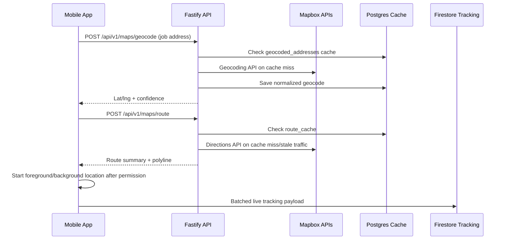

> Execution order: `06`  
> Parent phase: [Phase 1 — Build & Seed (M1–M8)](../phase_1_build_seed.md)  
> Previous: [📌 Module 1.5: Tradie Subscription, Plans & Entitlements](./05_module_1_5_tradie_subscription_plans_entitlements.md)

## 📌 Module 1.6: Mapbox Routing, Geocoding & Location Foundation
**Timeline**: Month 2
**Focus**: Shared Mapbox infrastructure for commute routing, customer live tracking, nearby supplies, and future enterprise dispatch maps.

### Business Value & Adoption Evaluation

**User intention**: "Get me to the job, show customers where I am when I choose to share, and help me find nearby suppliers without opening five different apps."

**Why users will use it**:
*   Routing and ETA make the job detail screen operational, not just informational.
*   Customer tracking reduces interruption calls during commute.
*   A single shared map foundation prevents inconsistent routing behaviour across phases.

**Adoption risk**:
*   Inaccurate ETA or stale location will damage customer trust.
*   Excessive background GPS usage can drain battery and lead users to disable permissions.
*   Mapbox API overuse can create unexpected cost if routing/geocoding calls are not cached or rate-limited.

**Retention mechanism**:
*   Route history, arrival reliability, service area logic, and supplier searches compound into operational intelligence over time.

**Migration support**:
*   Users can enter jobs by address first; geocoding turns existing diary/SMS jobs into routable app jobs.
*   Mapbox should enhance workflow without requiring full historical migration.

**Success metrics**:
*   Address geocode success rate.
*   Route calculation success rate.
*   ETA accuracy against actual arrival time.
*   Battery usage per active commute hour.
*   Mapbox API calls per active job.
*   Permission opt-in rate for foreground and background location.

**Build detail additions**:
*   Centralize all Mapbox access in shared services; feature screens must not call Mapbox directly.
*   Cache geocoding and route responses where safe.
*   Track stale location, low accuracy, permission denied, and route unavailable states.
*   Add Mapbox cost monitoring by endpoint and feature source.

### 📱 Mobile UX & UI Specifications (React Native)

> **Design System Instruction**: Implement this UI using `TradieMate_Design_System.html` v1.0 tokens: light mode only, base `#FAFAF8`, elevated cards `#FFFFFF`, CTA `#2E6B45`, semantic success/warning/danger/info colors, Inter typography, 4px spacing scale, `8px` element radius, `12px` card radius, minimum `44px` touch targets, `0.5px` borders, no shadows, no gradients, and MaterialCommunityIcons with explicit size/color, preferring library icons over typed text symbols for actions and statuses. This supersedes any older orange CTA, thick-border, or hard-shadow wording in the detailed bullets below. Build this UI from shared primitives in `packages/ui` (`AppButton`, `IconButton`, `AppCard`, `StatusBadge`, `EmptyState`, `FormField`, `Stepper`, `SwipeConfirm`, `ModalShell`, `MapPanel`) before creating module-local components.

#### 🗺️ Shared Map Component
*   **Component**: Build a reusable `TradieMapView` wrapper around `@rnmapbox/maps`.
*   **Map Style**: Use a light Mapbox style only. Match app UI with warm neutral surrounding panels; do not apply dark map themes by default.
*   **Camera Behaviour**:
    *   On job detail: fit current location and destination with `24px` padding.
    *   On active commute: follow tradie location unless user manually pans; show a `Recenter` control after manual pan.
    *   On customer tracking web: fit route/destination and animate marker smoothly between 5-second updates.
*   **Markers**:
    *   Destination marker uses MCI `map-marker` visual treatment in `#2E6B45`.
    *   Tradie marker uses MCI `truck` visual treatment in `#2E6B45`.
    *   Warning/stale markers use `#BA7517`; unavailable/error states use `#E24B4A`.
*   **Route Line**:
    *   Active route line uses `#378ADD` (`--info`) at high contrast.
    *   Completed route progress can be shown with a muted `#D3D1C7` segment.
*   **ETA Panel**:
    *   Render as a compact elevated card (`#FFFFFF`, `0.5px` border, `12px` radius).
    *   Show ETA, distance, and confidence state: `LIVE`, `STALE`, `NO SIGNAL`, or `ROUTE UNAVAILABLE`.

#### 📍 Location Permission UX
*   **Foreground Permission**:
    *   Required before showing current location, route preview, or nearby supplies.
    *   Explain value in plain language: *"TradieMate uses your location to route to jobs and find nearby suppliers."*
*   **Background Permission**:
    *   Requested only when the tradie starts commute tracking.
    *   Explain that location sharing stops when commute ends.
*   **Denied State**:
    *   Show a non-blocking card with `Open Settings` and `Enter location manually`.
*   **Privacy Rule**:
    *   Never start customer-visible tracking until the tradie explicitly starts commute.
    *   Never expose historical location trail to the customer; customer sees only current position, ETA, and route context.

---

### 🔌 API, Mobile Service & Database Specification

#### 📦 Mobile SDK Setup
*   Install `@rnmapbox/maps`.
*   Store public Mapbox token in environment/config:
    *   Mobile: `MAPBOX_PUBLIC_TOKEN`
    *   API server token for geocoding/directions proxy, if used: `MAPBOX_SECRET_TOKEN`
*   iOS:
    *   Add location usage descriptions: `NSLocationWhenInUseUsageDescription`, `NSLocationAlwaysAndWhenInUseUsageDescription`.
    *   Configure background location only for active commute tracking.
*   Android:
    *   Add `ACCESS_FINE_LOCATION`, `ACCESS_COARSE_LOCATION`, and background location permission where required.
    *   Request background location progressively, not during first app launch.

#### 🧭 Shared Mobile Services
```typescript
type LatLng = {
  latitude: number;
  longitude: number;
};

type RouteSummary = {
  distanceMeters: number;
  durationSeconds: number;
  trafficDurationSeconds?: number;
  polyline: string;
  calculatedAt: string;
};

type LocationAccuracyState = 'PRECISE' | 'APPROXIMATE' | 'STALE' | 'DENIED' | 'UNAVAILABLE';

interface MapboxLocationService {
  requestForegroundPermission(): Promise<boolean>;
  requestBackgroundPermissionForCommute(): Promise<boolean>;
  getCurrentLocation(): Promise<LatLng & { accuracyMeters?: number; heading?: number; speedMetersPerSecond?: number }>;
  watchCommuteLocation(jobId: string): Promise<void>;
  stopCommuteLocation(jobId: string): Promise<void>;
}

interface MapboxRoutingService {
  geocodeAddress(address: string): Promise<LatLng & { formattedAddress: string; confidence: number }>;
  reverseGeocode(point: LatLng): Promise<{ formattedAddress: string }>;
  getDrivingRoute(origin: LatLng, destination: LatLng): Promise<RouteSummary>;
}
```

#### 🗄️ Drizzle Database Schema (`src/db/schema.ts`)
```typescript
import { integer, jsonb, pgTable, text, timestamp, uuid, varchar } from 'drizzle-orm/pg-core';

export const geocodedAddresses = pgTable('geocoded_addresses', {
  id: uuid('id').defaultRandom().primaryKey(),
  normalizedAddress: text('normalized_address').notNull(),
  formattedAddress: text('formatted_address').notNull(),
  latitudeMicro: integer('latitude_micro').notNull(), // latitude * 1_000_000
  longitudeMicro: integer('longitude_micro').notNull(), // longitude * 1_000_000
  confidence: integer('confidence').notNull(), // 0-100
  provider: varchar('provider', { length: 50 }).default('MAPBOX').notNull(),
  providerPlaceId: varchar('provider_place_id', { length: 255 }),
  createdAt: timestamp('created_at', { withTimezone: true }).defaultNow().notNull(),
  updatedAt: timestamp('updated_at', { withTimezone: true }).defaultNow().notNull(),
});

export const routeCache = pgTable('route_cache', {
  id: uuid('id').defaultRandom().primaryKey(),
  originGeohash: varchar('origin_geohash', { length: 20 }).notNull(),
  destinationGeohash: varchar('destination_geohash', { length: 20 }).notNull(),
  profile: varchar('profile', { length: 40 }).default('driving-traffic').notNull(),
  distanceMeters: integer('distance_meters').notNull(),
  durationSeconds: integer('duration_seconds').notNull(),
  trafficDurationSeconds: integer('traffic_duration_seconds'),
  polyline: text('polyline').notNull(),
  providerPayload: jsonb('provider_payload'),
  expiresAt: timestamp('expires_at', { withTimezone: true }).notNull(),
  createdAt: timestamp('created_at', { withTimezone: true }).defaultNow().notNull(),
});

export const locationEvents = pgTable('location_events', {
  id: uuid('id').defaultRandom().primaryKey(),
  tradieId: uuid('tradie_id').notNull(),
  jobId: uuid('job_id'),
  eventType: varchar('event_type', { length: 80 }).notNull(), // PERMISSION_GRANTED | PERMISSION_DENIED | ROUTE_STARTED | ROUTE_FAILED | STALE_LOCATION
  metadata: jsonb('metadata'),
  createdAt: timestamp('created_at', { withTimezone: true }).defaultNow().notNull(),
});
```

#### 🛣️ Endpoints Details

##### 1. `POST /api/v1/maps/geocode`
*   **Auth**: Bearer JWT.
*   **Request Body**:
    ```json
    {
      "address": "45 Bunnings Rd, Fortitude Valley QLD 4006"
    }
    ```
*   **Business Logic**:
    *   Normalize address string.
    *   Check `geocoded_addresses` cache first.
    *   If cache miss, call Mapbox Geocoding API.
    *   Store latitude/longitude as integer microdegrees and return decimal values to client.
    *   If confidence is low, return a warning requiring user confirmation before saving to job.
*   **Response (`200 OK`)**:
    ```json
    {
      "success": true,
      "data": {
        "formattedAddress": "45 Bunnings Road, Fortitude Valley QLD 4006",
        "latitude": -27.45678,
        "longitude": 153.03456,
        "confidence": 92
      }
    }
    ```

##### 2. `POST /api/v1/maps/route`
*   **Auth**: Bearer JWT.
*   **Request Body**:
    ```json
    {
      "origin": { "latitude": -27.456, "longitude": 153.034 },
      "destination": { "latitude": -27.470, "longitude": 153.020 },
      "profile": "driving-traffic"
    }
    ```
*   **Business Logic**:
    *   Validate coordinates are within Australia unless explicitly allowed for test/dev.
    *   Check route cache by origin/destination geohash and profile.
    *   Call Mapbox Directions API with `driving-traffic`.
    *   Return distance, ETA, traffic ETA, and encoded polyline.
    *   Cache short-lived traffic routes for 5 minutes.
*   **Response (`200 OK`)**:
    ```json
    {
      "success": true,
      "data": {
        "distanceMeters": 5400,
        "durationSeconds": 720,
        "trafficDurationSeconds": 840,
        "polyline": "encoded_polyline_here",
        "calculatedAt": "2026-05-27T09:15:00+10:00"
      }
    }
    ```

##### 3. `POST /api/v1/maps/location-event`
*   **Auth**: Bearer JWT.
*   **Request Body**:
    ```json
    {
      "jobId": "7fa85c8e-5b12-42da-912f-92762a4d3345",
      "eventType": "STALE_LOCATION",
      "metadata": {
        "accuracyMeters": 120,
        "ageSeconds": 95
      }
    }
    ```
*   **Business Logic**:
    *   Record important location/routing failures for support and product analytics.
    *   Do not store continuous raw GPS trails here; live commute tracking is handled by batched Firestore writes.
*   **Response (`200 OK`)**:
    ```json
    {
      "success": true,
      "data": {
        "recorded": true
      }
    }
    ```

### 🔥 Firestore Tracking Payload

Live tracking writes must use a compact payload and be batched client-side:

```json
{
  "jobId": "job-uuid",
  "tradieId": "tradie-uuid",
  "latitude": -27.45678,
  "longitude": 153.03456,
  "heading": 84,
  "speedMetersPerSecond": 12.4,
  "accuracyMeters": 8,
  "etaSeconds": 840,
  "distanceRemainingMeters": 5400,
  "routePolyline": "encoded_polyline_here",
  "status": "COMMUTING",
  "updatedAt": "2026-05-27T09:15:00+10:00",
  "staleAfterSeconds": 20
}
```

**Rate limits**:
*   Mobile collects up to 20 raw GPS points per batch.
*   Firestore write rate remains max 1 write per GPS batch.
*   Customer web polling remains capped at 5000ms.
*   Route recalculation occurs only when the tradie deviates meaningfully from the current route or traffic ETA is older than 5 minutes.

### 🔄 Mapbox Workflow



### 🧪 Verification Checklist

*   Install and run `@rnmapbox/maps` on iOS simulator, Android emulator, and at least one physical device.
*   Verify foreground permission denied state allows manual address entry.
*   Verify background permission is requested only when commute tracking starts.
*   Geocode a valid Brisbane address and confirm cache hit on second request.
*   Geocode an ambiguous address and confirm low-confidence warning appears.
*   Calculate a `driving-traffic` route and render polyline, destination marker, tradie marker, ETA, and distance.
*   Simulate stale GPS by pausing location updates and confirm UI shows `STALE` state.
*   Start live tracking, confirm Firestore writes are batched and customer web polling stays at 5000ms.
*   Force Mapbox Directions API failure and confirm fallback copy appears without crashing the commute screen.
*   Track Mapbox API call count per feature source: `JOB_DETAIL`, `CUSTOMER_TRACKING`, `SUPPLIES`, `ENTERPRISE_DISPATCH`.

---
