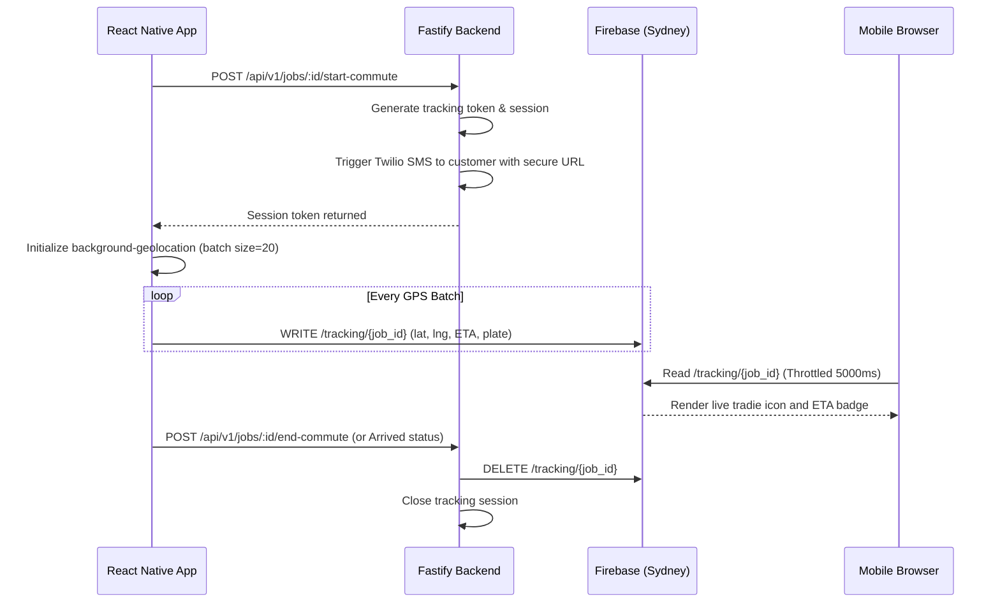

> Execution order: `01`  
> Parent phase: [Phase 2 — Transition & Grow (M9–M18)](../phase_2_transition_grow.md)  
> Previous: [Phase Overview](./00_phase_overview.md)

## 📌 Module 2.1: Customer Live Geolocation Tracking
**Timeline**: Months 9–10
**Focus**: Uber-style live map updates. Customers track the tradie's ETA en route via a mobile web browser link without downloading an app or logging in.

### Business Value & Adoption Evaluation

**User intention**: "I am on the way; stop the customer from calling me three times asking where I am."

**Why users will use it**:
*   It reduces interruption while driving or working.
*   It makes a small operator feel more like a professional service company.
*   It creates a visible customer experience that competitors using only SMS do not provide.

**Adoption risk**:
*   Privacy concerns if tradies feel constantly tracked.
*   Battery drain or inaccurate ETA can cause the feature to be disabled.
*   Customers may not open the link if the SMS copy does not clearly explain value.

**Retention mechanism**:
*   Customers associate the tradie's professionalism with TradieMate-powered communication.
*   Tracking sessions produce arrival reliability data that can later improve scheduling and dispatch.

**Migration support**:
*   Sell as a standalone upgrade: "Send customers an Uber-style arrival link without changing your whole workflow."
*   Let tradies use tracking only after tapping `Start Commute`; no always-on location.

**Success metrics**:
*   Tracking link send rate per commute.
*   Customer link open rate.
*   Repeat customer messages/calls during commute compared with baseline.
*   Battery impact per active tracking hour.
*   Percentage of tradies who reuse tracking on 3+ jobs.

**Build detail additions**:
*   Add a `locationSharingConsentAt` field and in-app privacy copy.
*   Add analytics events: `tracking_started`, `tracking_link_sent`, `tracking_page_opened`, `tracking_ended`.
*   Add fallback SMS if live tracking fails: "Dave is still on the way; ETA unavailable due to signal."
*   Reuse Module 1.6 Mapbox services for route polyline, ETA, marker styling, location permission state, and stale-location handling.

### 📱 Tradie Mobile UX (React Native App)

> **Design System Instruction**: Implement this UI using `TradieMate_Design_System.html` v1.0 tokens: light mode only, base `#FAFAF8`, elevated cards `#FFFFFF`, CTA `#2E6B45`, semantic success/warning/danger/info colors, Inter typography, 4px spacing scale, `8px` element radius, `12px` card radius, minimum `44px` touch targets, `0.5px` borders, no shadows, no gradients, and MaterialCommunityIcons with explicit size/color, preferring library icons over typed text symbols for actions and statuses. This supersedes any older orange CTA, thick-border, or hard-shadow wording in the detailed bullets below. Build this UI from shared primitives in `packages/ui` (`AppButton`, `IconButton`, `AppCard`, `StatusBadge`, `EmptyState`, `FormField`, `Stepper`, `SwipeConfirm`, `ModalShell`, `MapPanel`) before creating module-local components.
*   **Active Commute Control**: The tradie starts the commute using the swipe slider from Module 1.1. Once active, the app background service triggers high-frequency GPS tracking.
*   **Status Indicators**: A status header shows target coordinates, speed, and status mapping.
*   **Route Source**: Use Module 1.6 `MapboxRoutingService.getDrivingRoute` for ETA and route polyline. Do not call Mapbox directly from the tracking screen.

### 🖥️ Customer Web Tracking UX (Mobile-Responsive Web Page)

> **Design System Instruction**: Implement this UI using `TradieMate_Design_System.html` v1.0 tokens: light mode only, base `#FAFAF8`, elevated cards `#FFFFFF`, CTA `#2E6B45`, semantic success/warning/danger/info colors, Inter typography, 4px spacing scale, `8px` element radius, `12px` card radius, minimum `44px` touch targets, `0.5px` borders, no shadows, no gradients, and MaterialCommunityIcons with explicit size/color, preferring library icons over typed text symbols for actions and statuses. This supersedes any older orange CTA, thick-border, or hard-shadow wording in the detailed bullets below. Build this UI from shared primitives in `packages/ui` (`AppButton`, `IconButton`, `AppCard`, `StatusBadge`, `EmptyState`, `FormField`, `Stepper`, `SwipeConfirm`, `ModalShell`, `MapPanel`) before creating module-local components.
*   *Note: There is no native customer mobile app; all customer tracking is done on a responsive web page.*
*   **Aesthetic & Layout Compliance**:
    *   Map occupies the upper `55%` of the browser window. Centered on the active route.
    *   Lower Card Container (`45%` height) uses `#FFFFFF` (`--bg-elevated`), `0.5px` border outline (`#E8E6E0`), `12px` radius, and no shadow.
    *   **Tradie Card details**: Shows a circular avatar (`56px` diameter for featured tradie identity), vehicle license plate text (`15px/500`, uppercase, spaced for readability), and star rating badge.
*   **Map Marker Interpolation**:
    *   To prevent the tradie marker from jumping abruptly on the customer's map, interpolate coordinate updates smoothly.
    *   *Web JS implementation*: Use requestAnimationFrame to animate latitude and longitude changes over the `5000ms` polling window.
    *   Use the same marker semantics as Module 1.6: tradie marker uses truck treatment, destination uses map-marker treatment, stale state uses Warning.
*   **ETA Badge**:
    *   Positioned in the upper right. Uses a bright Forest Green CTA background (`#2E6B45`) with black text. If the ETA increases by more than 5 minutes due to traffic, change the badge color to Danger Red (`#E24B4A`) and flash the border.
*   **"Call Tradie" Action**: Large, green button (`#2E6B45`) with a `44px` minimum height. Pressing triggers a native call hook opening the browser/mobile native dialer.
*   **"Cancel Booking" Action**: Placed at the bottom in a muted red text outline. Prompts a confirmation dialog: *"Are you sure you want to cancel this booking?"* to prevent accidental cancellations.

---

### 🔌 API & Database Specification

#### 🗄️ Drizzle Database Schema (`src/db/schema.ts`)
```typescript
import { boolean } from 'drizzle-orm/pg-core';

export const trackingSessions = pgTable('tracking_sessions', {
  id: uuid('id').defaultRandom().primaryKey(),
  jobId: uuid('job_id').notNull(),
  token: varchar('token', { length: 255 }).notNull().unique(), // UUIDv4 Token
  isActive: boolean('is_active').default(true).notNull(),
  expiresAt: timestamp('expires_at', { withTimezone: true }).notNull(),
  createdAt: timestamp('created_at', { withTimezone: true }).defaultNow().notNull(),
});
```

#### 🛣️ Endpoints Details

##### 1. `POST /api/v1/jobs/:id/start-commute`
*   **Auth**: Bearer JWT.
*   **Request Body**: `{}`
*   **Business Logic**:
    *   Verify the job exists and belongs to the authenticated tradie. If not, return `404 Not Found`.
    *   Generate a unique `token` (UUIDv4) for customer tracking.
    *   Set `expiresAt` to exactly 4 hours from the current time.
    *   Create a document in Firestore `/tracking/{jobId}` containing:
        ```json
        {
          "jobId": "job-uuid",
          "latitude": 0.0,
          "longitude": 0.0,
          "eta": "Calculating...",
          "status": "COMMUTING",
          "plateNumber": "TRD-888"
        }
        ```
    *   Dispatch Twilio SMS to the customer: *"Dave is en route. Track arrival: https://tradiemate.com.au/track/:token"*.
*   **Response (`201 Created`)**:
    ```json
    {
      "success": true,
      "data": {
        "trackingToken": "d3a95c8e-5b12-42da-912f-92762a4d5578",
        "trackingUrl": "https://tradiemate.com.au/track/d3a95c8e-5b12-42da-912f-92762a4d5578"
      }
    }
    ```
*   **Workflow Evaluation**:
    *   **Pre-conditions**: Job `$JOB_ID` belongs to auth tradie. JWT stored in `$TOKEN`.
    *   **Test Request**:
        ```bash
        curl -X POST -H "Authorization: Bearer $TOKEN" "http://localhost:3000/api/v1/jobs/$JOB_ID/start-commute"
        ```
    *   **Expected Assertions**:
        *   **HTTP Status**: `201 Created`
        *   **Response**: Standardized envelope with `success: true` and tracking details inside `data`.
        *   **Database Validation**: Row created in `tracking_sessions` table with `isActive: true` and `expiresAt` set to +4 hours.
        *   **Side Effects**: Firestore document `/tracking/$JOB_ID` created with starting coordinates. Twilio SMS dispatched containing tracking URL to customer phone.

##### 2. `POST /api/v1/jobs/:id/end-commute`
*   **Auth**: Bearer JWT.
*   **Response (`200 OK`)**:
    ```json
    {
      "success": true,
      "data": {
        "message": "Commute tracking completed."
      }
    }
    ```
*   **Business Logic**:
    *   Verify job ownership.
    *   Set `isActive` to `false` in `tracking_sessions`.
    *   Delete the real-time document `/tracking/{jobId}` from Firestore.
*   **Workflow Evaluation**:
    *   **Pre-conditions**: Active tracking session exists for `$JOB_ID`. JWT stored in `$TOKEN`.
    *   **Test Request**:
        ```bash
        curl -X POST -H "Authorization: Bearer $TOKEN" "http://localhost:3000/api/v1/jobs/$JOB_ID/end-commute"
        ```
    *   **Expected Assertions**:
        *   **HTTP Status**: `200 OK`
        *   **Response**: Standardized envelope with `success: true` and success message inside `data`.
        *   **Database Validation**: Row in `tracking_sessions` matching job is updated to `isActive: false`.
        *   **Side Effects**: Firestore document `/tracking/$JOB_ID` deleted from Firebase.

### 🔄 Action Workflow: Live Tracking Lifecycle


---
